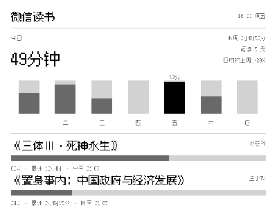

# weread-ink

微信读书阅读统计 → 墨水屏仪表盘。拉取你的微信读书数据（本周每日时长、在读好书进度），
渲染 400×300 像素风面板，推送到局域网内的 Zectrix Note 4 墨水屏设备常驻显示。

> 📖 **[完整使用教程（TUTORIAL.md）](TUTORIAL.md)** —— 从零到上屏的逐步指南：
> 申请 Key、编译配置、首次推屏、开机自启、排障手册与个性化。



- **点阵像素字体**（Fusion Pixel 12px，阈值二值化渲染，边缘锐利无抗锯齿）
- **2bpp 四灰阶**（Gray4）显示：黑字 / 深灰数据 / 浅灰轨道，灰阶经过线性光校准
- 长驻设备会话 + 断线自愈 + Mac 睡眠唤醒秒级恢复
- 一次推送 = 取数 → 渲染 → 推屏，全部在本地完成

```
┌────────────────────────────────┐
│ 微信读书            10-23 周五  │
│ 今日 45分钟      本周 4小时20分  │
│                 阅读 5 天 +20%  │
│  ▁ ▃ ▅ ▂ ▇ ▆ ▄                │
│  一 二 三 四 五 六 日            │
│ 《三体Ⅲ·死神永生》      刘慈欣   │
│ ████████████░░░░░░  62%        │
│ 62% · 累计 12小时 · 今天 23:40  │
└────────────────────────────────┘
```

## 架构

```
launchd（KeepAlive 常驻）
   │
   ▼
weread-ink --daemon --interval 1800
   ├─ src/weread.rs   微信读书官方 Agent API Gateway 客户端
   ├─ src/render.rs   400×300 渲染：柱状图 + 进度条 + 点阵中文排版
   ├─ src/font.rs     字体发现（WEREAD_FONT → fonts/ 内置点阵字体 → 系统字体）
   ├─ src/push.rs     Zectrix 推屏与重试
   └─ src/lib.rs      daemon：长驻会话 + 事件排水 + 缓存帧恢复
```

数据接口来自微信读书官方 Skill（[Tencent/WeChatReading](https://github.com/Tencent/WeChatReading)）。

## 环境要求

- Rust stable（含 tokio 异步运行时）
- 一台 Zectrix Note 4 设备（固件 3.7.2，zectrix-s3-epaper-4.2）
- 微信读书 API Key（`wrk-` 开头，[官方页面申请](https://weread.qq.com/r/weread-skills)）

## 快速开始

```bash
# 0) 获取设备 SDK（两个仓库放在同级目录）
git clone https://github.com/itopinion/zectrix-local-push-sdk.git ../zectrix-local-push-sdk

# 1) 预览渲染效果（不需要 API Key 和设备）
cargo run --example sample && open sample.png

# 2) 配置
cp .env.example .env    # 填入 WEREAD_API_KEY，可选 WEREAD_DEVICE_TARGET

# 3) 只渲染不推屏（验证取数 + 渲染链路）
cargo run --bin weread-ink -- --dry-run dashboard.png

# 4) 推屏
cargo run --bin weread-ink -- --target 192.168.1.100

# 5) 常驻模式（每 30 分钟自动刷新，推荐配 launchd）
cargo run --bin weread-ink -- --daemon

# 6) 测试（假网关 + loopback，无需网络和设备）
cargo test
```

> 设备 SDK 默认按路径依赖 `../zectrix-local-push-sdk`。如果不想按目录放置，
> 可把 `Cargo.toml` 中的依赖改为 git 方式：
> `zectrix-sdk = { git = "https://github.com/itopinion/zectrix-local-push-sdk" }`

## 配置

| 环境变量 / CLI 参数 | 必填 | 说明 |
| --- | --- | --- |
| `WEREAD_API_KEY` | 是 | 微信读书 Agent API Gateway 的 Key |
| `WEREAD_DEVICE_TARGET` / `--target` | 否 | 设备 IPv4 / `IPv4:端口` / 12 位设备 ID；省略则自动发现唯一设备 |
| `WEREAD_FONT` / `--font` | 否 | 字体路径；省略用 `fonts/` 内置点阵字体 |
| `WEREAD_INTERVAL` / `--interval` | 否 | daemon 刷新间隔秒数，默认 1800 |
| `--format` | 否 | `mono` / `gray4` / `gray16`，默认 `gray4`（2bpp） |
| `--dry-run <FILE>` | 否 | 只渲染并保存 PNG，不连接设备 |

CLI 启动时自动加载项目目录下 `.env`（`KEY=VALUE` 行，不覆盖已有环境变量）。
**`.env` 已在 `.gitignore` 中，密钥不会入库。**

## 定时常驻（launchd）

```xml
<!-- ~/Library/LaunchAgents/com.weread.ink.plist，ProgramArguments 指向 release 二进制：
     /path/to/weread-ink/target/release/weread-ink --daemon --interval 1800
     并设置 RunAtLoad + KeepAlive + WorkingDirectory=项目目录 -->
```

```bash
cargo build --release
launchctl bootstrap gui/$(id -u) ~/Library/LaunchAgents/com.weread.ink.plist

tail -f weread-ink.err.log                    # 实时日志（全部走 stderr，带时间戳）
launchctl kickstart -k gui/$(id -u)/com.weread.ink   # 重启
launchctl bootout gui/$(id -u)/com.weread.ink        # 停止
```

## 设备固件怪癖（实测结论，2026-10）

针对 zectrix-s3-epaper-4.2 / 固件 3.7.2，均为实测踩坑结论：

1. **显示提交后立刻断开连接会取消物理刷新**——协议照常应答"完成"但屏幕不动。
   推送成功后必须保持连接（SDK 心跳每 5 秒）数秒再关闭；daemon 模式则长驻不断。
2. **管理连接断开后设备把屏幕回滚到上一会话画面**——常驻显示必须维持会话。
3. 设备会不定期主动掐断会话（DeviceExit / WiFi 省电超时）——daemon 需自动重连
   并立即补推缓存帧。
4. Mac 睡眠会冻结心跳与定时器——唤醒后需要秒级感知并恢复（事件排水 +
   `tokio::select!` 中断定时长等待）。
5. 设备 WiFi 深度省电时 2 秒探测可能落空（表现为"没有发现可用设备"）——短退避重试即可。

以上均已在本项目 daemon 中处理，详见 `src/push.rs` 与 `src/lib.rs`。

## 已知口径（来自微信读书官方 Skill 文档）

- 阅读时长一律是**秒**；本周总量用 `totalReadTime`，`readTimes` 只做每日明细。
- `progress` 是 0–100 整数，**1 = 1%**，只有 100 且带 `finishTime` 才是读完。
- 阅读统计只有 周/月/年/总计 四种周期，无单日接口；"今日"取 weekly 的 `readTimes`
  中今天的桶。
- 回包出现 `upgrade_info` 时 SDK 返回 `UpgradeRequired` 并停止请求。

## 测试

沿用"模拟先行"思路，18 个测试无需网络、API Key 和设备：

- 解析器单测：weekly 桶对齐、进度 0..=100 严格校验、信封三形态
- 渲染单测：400×300、柱高成比例、今天黑色高亮、**进度条深灰填充**、
  **文字二值化（无中间灰）**、两本书时底部留白
- 集成测试：loopback HTTP 假网关（可注入"需升级/鉴权失败"剧本）走真实 reqwest
  全链路，含鉴权头与 skill_version 断言

## 许可

- 本项目代码：MIT
- 内置字体 `fonts/fusion-pixel-12px-proportional.ttf`：Fusion Pixel Font，
  Copyright (c) 2022 TakWolf，OFL 1.1（全文见 `fonts/fusion-pixel-LICENSE.txt`）
- 设备通信基于 [zectrix-local-push-sdk](https://github.com/itopinion/zectrix-local-push-sdk)（MIT）
